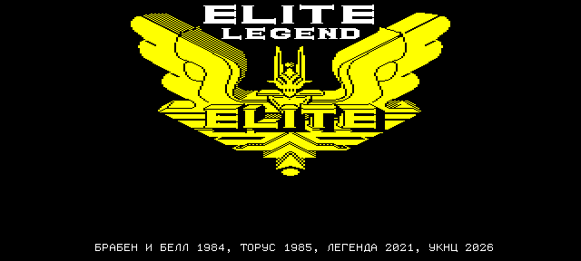
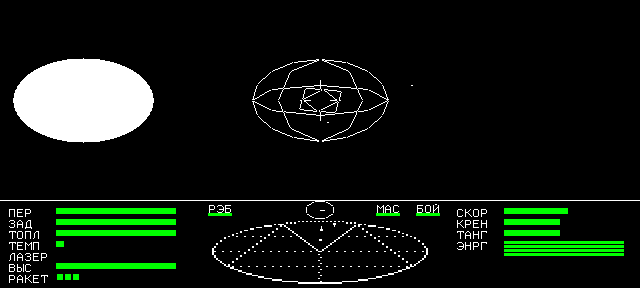
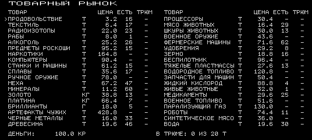
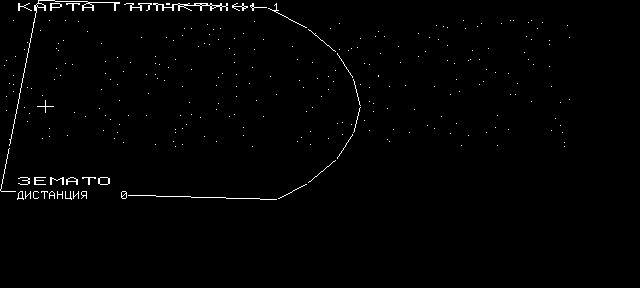

# Elite Legend for Электроника МС-0511 (УКНЦ)

"Весьма альфа" версия продвинутой версии Elite на новую платформу.
К игре прилагаются инструкции - в файлах релиза. Пока статус "вроде играбельно 
но есть проблемы" - обратная связь всячески приветствуется.

Репозиторий содержит полный toolchain для сборки проекта (Ubuntu Linux).






A Russian-language Elite Legend port for the УКНЦ, written in MACRO-11
with hardware MUL/DIV and a 640×288 display. Version **0.8.0** builds as a
bootable RT-11 disk containing `ELITE.SAV`, `ELITE.DAT` and normal commander
files. Original game files and third-party binaries are supplied locally, not
tracked in this repository.

## Build and play

For a fresh checkout, follow [setup](docs/setup.md): run `make toolchain`
and supply the two RT-11 inputs under `orig/rt11/` before building.

```sh
make build     # build/elite.dsk
make run       # refresh saves/elite.dsk and launch the SDL player
make shot      # headless logo screenshot at tmp/run-shot.png
make verify    # build and run the regression suite
```

Python 3, Pillow and the local tools under `bin/` are required for these
workflows. `make toolchain` builds the assembler and UKNCBTL runners under
`tmp/` and installs their results under `bin/`; it uses the host build tools
and SDL2 runtime. See [tools](docs/tools.md) for dependencies and CLIs.

Press **Enter twice**, once on each startup page, then **Left Ctrl** at the
Elite logo. Select commander slot **1–4**; an empty slot asks for a name.
Flight uses arrows to steer, Left Ctrl to fire, Right Ctrl/keypad Enter to
cycle throttle, and Space to lock/perform the function selected with `8`.
Esc cycles screens and Tab opens pause. **Tab, then X exits to RT-11 without
saving**: dock or save through the access menu first.

The complete map is [KEYBOARD.md](KEYBOARD.md). Player documentation is
Russian, with current screenshots and default UKNC/PC bindings:

- `manual.pdf`: game systems, equipment, contracts, missions and lore.
- `control.pdf`: UKNC controls.
- `controls-pc.pdf`: PC controls.

Get these files with the release, or generate them locally with `make docs`.
The PDFs and `build/elite.dsk` are release assets and excluded from Git.

## Game scope

The port includes 69 object headers on 55 hulls, sixteen universe slots,
nineteen purchasable ships and their cockpit limits, 38 market goods, a
49-row equipment catalogue, carrier contracts and four named commander
slots. Flight includes four views, eight laser types, missiles, ECM, bombs,
cloaking, boarding, Targlets, scooping, docking, J-drive and injectors.
Forty-eight galaxies, three galactic drives and Legend's mission systems
are implemented. Jumps apply wear, automatic repair and cargo life support.

Screens use the UKNC 8×11 font. The renderer includes NPC beams, a filled
sun, stars, gauges and status lamps. Legend's AY effects use one chip; the
port's Blue Danube plays on the second for the title and docking.

The attract demo is deferred. Cargo discard, ore processing and target-lock
enhancement remain catalogue items without a distinct gameplay effect.
See [compatibility and limits](docs/compatibility.md) for the complete
set of intentional differences and unsupported features.

## Player disks and RT-11

`make run` uses **saves/elite.dsk**, which survives `make clean`. Refresh
preserves the four `ELSAV1.DAT` … `ELSAV4.DAT` commander files and keeps the
previous image as `.bak`. Recognized legacy raw disks migrate automatically;
unrecognized ones fail without replacement. Refresh replaces other disk
contents with the build volume, so preserve unrelated files separately.

```sh
make run PLAY_DSK=saves/another.dsk
```

Tests use disposable disks under `tmp/`. Do not test save operations on a
player image or reconstruct it directly with the pristine disk builder.

The supplied RT-11 SJ V05.04 G monitor starts the game from `STARTS.COM`.
Manual launch requires both options:

```text
SET USR SWAP
SET EXIT SWAP
R ELITE
```

Keep matching SAV/DAT files on `DK:`. The monitor must provide memory
through octal `146400`, and the volume must be writable for swapping.
Exit restores the terminal and releases PPU allocations; `R ELITE` can
launch again. [RT-11 lifecycle](docs/rt11.md) explains file validation,
save failures, disk refresh and exit constraints.

## Development documentation

Start with [AGENTS.md](AGENTS.md) and the [documentation index](docs/README.md).
The references describe current architecture, final decisions, caveats and
reproducible checks. [Testing](docs/testing.md) distinguishes full-suite
results from focused checks; no clean full-suite run is recorded for the
current v0.8.0 runtime. [Rendering](docs/rendering.md) records the applicable
benchmark workload and evidence limits.

```sh
python3 tools/verify_build.py --only rt11
python3 tools/verify_build.py --only rules
python3 tools/bench.py --fixed --ticks 1200 --turning --shot tmp/turning.png
make docs          # rebuild all three PDFs offline
make docs-capture  # build game, recapture real screens, rebuild PDFs
```

PDF text, controls, artwork and screenshots are maintained under
[docs/manual/](docs/manual/README.md). The existing
[elite-tools skill](.agents/skills/elite-tools/SKILL.md) provides disk-refresh
and verification workflows for coding agents.

## Repository layout

| Path | Contents |
|---|---|
| `src/elite.list`, `src/ovl.list` | Resident memory order and overlay definitions |
| `src/res/` | Editable font, text, hulls, tables, art and effects |
| `tools/` | Build, extraction, disk, test and measurement CLIs |
| `orig/` | Ignored local reference/RT-11 inputs; tracked setup READMEs |
| `external/` | Ignored optional reference checkouts |
| `docs/` | Maintained technical references and player-document sources |
| `.agents/skills/` | Project agent workflows |
| `bin/` | Ignored local toolchain, emulator and firmware |
| `build/` | Generated programs, resources, listings and manifest |
| `saves/` | Persistent player disks and backups |
| `tmp/` | Disposable builds, tests, captures and measurements |

## License

[MIT, in English and Russian](LICENSE.md), covers Sergey's original port
contributions only. Original Elite/Legend content, ROM fonts, RT-11,
third-party code and artwork are excluded. The complete game and release
disk are not wholly MIT-licensed; see the [licensing assessment](docs/licensing.md)
for provenance, known permissions and unresolved distribution rights.

## Credits

Original Elite: David Braben and Ian Bell (1984); ZX Spectrum version by
Torus for Firebird (1985). Elite Legend: PLM. UKNC port: Сергей Лемешев
and ChatGPT Codex. Original game content remains its rights holders'
property. This is a preservation and porting project; its non-commercial
purpose does not restrict the MIT grant or establish third-party permission.

UKNCBTL by Nikita Zimin supplies the emulator core (LGPL). The assembler is
Richard Krehbiel's macro11; ZEsarUX (GPL) runs the Spectrum reference.
Platform work derives from the sibling MC-0511 ports; RT-11 inputs and file
tools came from `retro-game-mc0511-darkroom`. Provenance, reference formats
and ilynxy's scr256db permission are in [reference sources](docs/reference-sources.md).
